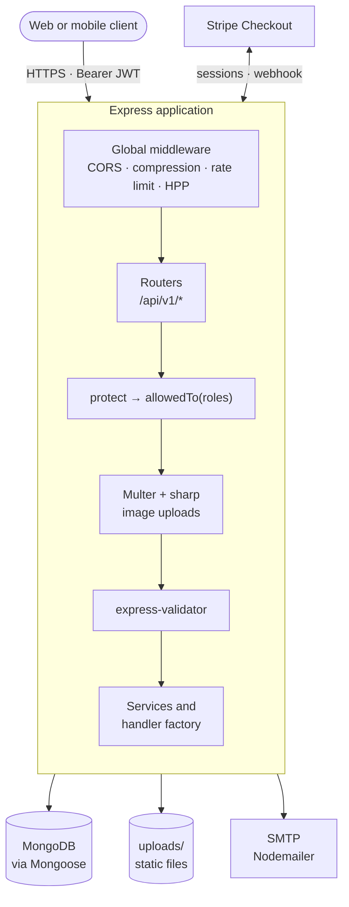
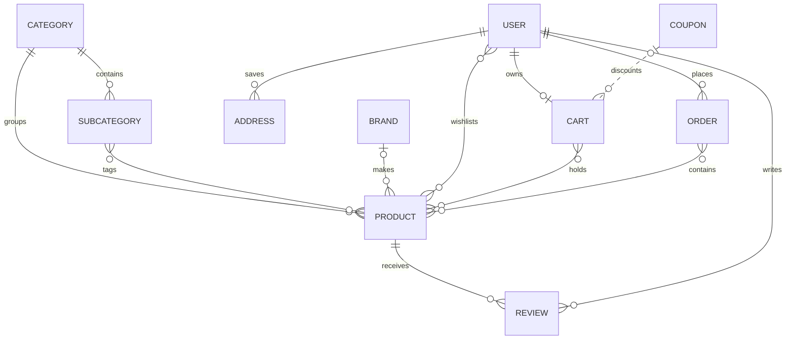
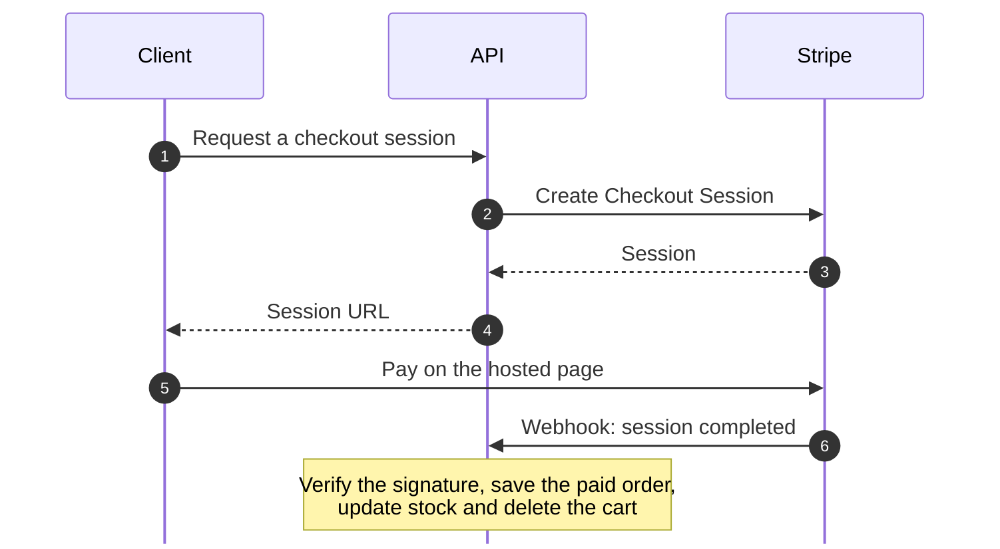

<div align="center">

# E-Commerce Backend

**REST API for an online store, built with Node.js, Express and MongoDB.** It covers the full shopping flow: a catalog of categories, subcategories, brands and products; customer accounts with JWT authentication and role-based access; reviews, wishlists and saved addresses; a cart with discount coupons; and orders paid in cash on delivery or by card through Stripe Checkout.

[](https://nodejs.org)
[](https://expressjs.com)
[](https://www.mongodb.com)
[](https://mongoosejs.com)
[](https://jwt.io)
[](https://stripe.com)
[](LICENSE)

</div>

## Highlights

- **Product catalog.** Categories contain subcategories, products belong to a category, optional subcategories and a brand, and every name gets a URL slug. A product has a price, an optional discounted price, colors, stock quantity and a sold counter.
- **Image processing.** Uploads are held in memory by Multer, accepted only when the file is an image, then resized with sharp and stored as JPEG: 2000×1333 for product images (one cover and up to five gallery images), 600×600 for categories, brands and profile photos. Product, category and brand responses return full image URLs.
- **Authentication and roles.** Sign-up and login issue a JWT, and passwords are hashed with bcrypt. Three roles, `user`, `manager` and `admin`, decide who can call each route. Changing a password invalidates every token issued before the change.
- **Password recovery by email.** A six-digit reset code is sent through Nodemailer, stored only as a SHA-256 hash, and expires after ten minutes.
- **Reviews and ratings.** A customer can review each product once and edit or delete only their own review. The product's average rating and review count are recalculated with an aggregation pipeline whenever a review is saved.
- **Cart and coupons.** Each customer has one cart. Adding the same product in the same color increases its quantity, and the total is recalculated on every change. Coupons apply a percentage discount and are rejected once they expire.
- **Orders and payments.** An order is created from the cart, either as cash on delivery or through a Stripe Checkout session. A signed Stripe webhook records card payments. Placing an order decreases stock, increases the sold counter and clears the cart. Managers and admins mark orders as paid and delivered.
- **Consistent list queries.** Every list endpoint supports filtering with comparison operators, keyword search, multi-field sorting, field selection and pagination.
- **Request validation.** express-validator rules guard the catalog, user, review and authentication routes. They check that the category exists, that the selected subcategories belong to it, that the discounted price is below the price, that an email is not already registered, and that a review belongs to the user changing it.
- **Security middleware.** CORS, gzip compression, a rate limit of 100 requests per 15 minutes per IP on the API, HTTP parameter pollution protection and a 20 KB limit on JSON bodies.

## Architecture



Shared create, read, update, delete and list handlers live in a single handler factory, so each resource service stays small. Expected failures are raised as `ApiError` instances and turned into JSON responses by one global error middleware.

### Domain model



Addresses and the wishlist are stored on the user document. An order keeps its own copy of the cart lines and prices, so later price changes never alter past orders.

### Card payment flow



## API

All routes are prefixed with `/api/v1`. Protected routes expect an `Authorization: Bearer <token>` header. In the tables below, **Public** needs no token, **Signed in** accepts any role, and **Customer** means the `user` role.

### Authentication: `/auth`

| Method | Path | Access | Description |
| --- | --- | --- | --- |
| `POST` | `/auth/signup` | Public | Create an account (`name`, `email`, `password`, `passwordConfirm`) and receive a token |
| `POST` | `/auth/login` | Public | Exchange email and password for a token |
| `POST` | `/auth/forgotPassword` | Public | Email a six-digit reset code |
| `POST` | `/auth/verifyResetCode` | Public | Verify the reset code |
| `PUT` | `/auth/resetPassword` | Public | Set a new password after verification and receive a token |

### Users: `/users`

| Method | Path | Access | Description |
| --- | --- | --- | --- |
| `GET` | `/users/getMe` | Signed in | Current user's profile |
| `PUT` | `/users/updateMe` | Signed in | Update name, email and phone |
| `PUT` | `/users/changeMyPassword` | Signed in | Change password and receive a new token |
| `DELETE` | `/users/deleteMe` | Signed in | Deactivate the account |
| `GET` `POST` | `/users` | Admin, Manager | List users or create one, with an optional profile photo |
| `GET` `PUT` `DELETE` | `/users/:id` | Admin, Manager | Read, update or delete a user |
| `PUT` | `/users/changePassword/:id` | Admin, Manager | Set a user's password |

### Catalog: `/categories`, `/subcategories`, `/brands`, `/products`

| Method | Path | Access | Description |
| --- | --- | --- | --- |
| `GET` | `/categories`, `/brands`, `/products`, `/subcategories` | Public | List with filtering, search, sorting and pagination |
| `GET` | `/categories/:id`, `/brands/:id`, `/subcategories/:id` | Public | Single record |
| `GET` | `/products/:id` | Public | Single product with its reviews |
| `GET` | `/categories/:categoryId/subcategories` | Public | Subcategories of one category |
| `POST` `PUT` | `/categories`, `/brands`, `/products`, `/subcategories` (and `/:id`) | Admin, Manager | Create or update a record |
| `POST` | `/categories/:categoryId/subcategories` | Admin, Manager | Create a subcategory under a category |
| `DELETE` | `/categories/:id`, `/brands/:id`, `/products/:id`, `/subcategories/:id` | Admin | Delete a record |

Image fields are sent as `multipart/form-data`: `image` for categories and brands, `imageCover` and `images` (up to five) for products, and `profileImg` for users.

### Reviews: `/reviews`

| Method | Path | Access | Description |
| --- | --- | --- | --- |
| `GET` | `/reviews`, `/products/:productId/reviews` | Public | List all reviews, or the reviews of one product |
| `GET` | `/reviews/:id` | Public | Single review |
| `POST` | `/reviews`, `/products/:productId/reviews` | Customer | Rate a product from 1 to 5, once per product |
| `PUT` | `/reviews/:id` | Customer | Edit your own review |
| `DELETE` | `/reviews/:id` | Customer, Admin, Manager | Customers delete their own reviews; staff can delete any review |

### Shopping: `/wishlist`, `/addresses`, `/cart`, `/coupons`

| Method | Path | Access | Description |
| --- | --- | --- | --- |
| `GET` `POST` | `/wishlist` | Customer | View the wishlist or add a product (`productId`) |
| `DELETE` | `/wishlist/:productId` | Customer | Remove a product from the wishlist |
| `GET` `POST` | `/addresses` | Customer | View saved addresses or add one (`alias`, `details`, `phone`, `city`, `postalCode`) |
| `DELETE` | `/addresses/:addressId` | Customer | Remove an address |
| `GET` `POST` `DELETE` | `/cart` | Customer | View the cart, add a product (`productId`, `color`) or clear the cart |
| `PUT` `DELETE` | `/cart/:itemId` | Customer | Change an item's quantity or remove it |
| `PUT` | `/cart/applyCoupon` | Customer | Apply a coupon by name |
| `GET` `POST` | `/coupons` | Admin, Manager | List coupons or create one (`name`, `expire`, `discount` in percent) |
| `GET` `PUT` `DELETE` | `/coupons/:id` | Admin, Manager | Read, update or delete a coupon |

### Orders: `/orders`

| Method | Path | Access | Description |
| --- | --- | --- | --- |
| `POST` | `/orders/:cartId` | Customer | Place a cash-on-delivery order with a `shippingAddress` |
| `GET` | `/orders/checkout-session/:cartId` | Customer | Create a Stripe Checkout session for card payment |
| `GET` | `/orders` | Customer, Admin, Manager | Customers see their own orders; staff see every order |
| `GET` | `/orders/:id` | Signed in | Single order with customer and product details |
| `PUT` | `/orders/:id/pay` | Admin, Manager | Mark an order as paid |
| `PUT` | `/orders/:id/deliver` | Admin, Manager | Mark an order as delivered |

Stripe calls `POST /webhook-checkout` (outside `/api/v1`) when a checkout completes. The route reads the raw request body so the Stripe signature can be verified.

### List queries

Every list endpoint accepts the same query parameters:

| Parameter | Example | Effect |
| --- | --- | --- |
| Field filters | `price[gte]=100&price[lte]=500` | Exact match, or a range with `gt`, `gte`, `lt` and `lte` |
| `keyword` | `keyword=backpack` | Case-insensitive search in product titles and descriptions, or in names for other resources |
| `sort` | `sort=-sold,price` | Sort by one or more fields; a leading `-` sorts in descending order |
| `fields` | `fields=title,price,imageCover` | Return only the listed fields |
| `page`, `limit` | `page=2&limit=20` | Pagination, 50 items per page by default |

```http
GET /api/v1/products?category=<categoryId>&ratingsAverage[gte]=4&sort=-sold&page=1&limit=10
```

List responses share one shape:

```json
{
  "results": 10,
  "paginationResult": { "currentPage": 1, "limit": 10, "numberOfPages": 4, "next": 2 },
  "data": [ ]
}
```

### Errors

Errors are returned as JSON with a matching HTTP status. Validation failures return `400` with an `errors` array that lists each invalid field. Other errors look like this:

```json
{ "status": "fail", "message": "You are not allowed to access this route" }
```

`status` is `fail` for 4xx errors and `error` for 5xx errors. When `NODE_ENV` is `development`, the response also includes the full error and its stack trace.

## Getting started

### Prerequisites

- Node.js 18 or later
- MongoDB, either a local server or a MongoDB Atlas cluster
- An SMTP account for password-reset emails
- A Stripe account for card payments (test keys are enough)

### Installation

```bash
git clone https://github.com/aymansalkhatib/ecommerce-backend.git
cd ecommerce-backend
npm install
```

### Configuration

Create a `config.env` file in the project root. It is listed in `.gitignore` and must never be committed.

```env
# Server
PORT=8000
NODE_ENV=development
BASE_URL=http://localhost:8000

# Database
DB_URI=mongodb://127.0.0.1:27017/ecommerce

# Authentication
JWT_SECRET_KEY=replace-with-a-long-random-string
JWT_EXPIRE_TIME=90d

# Email (the transport uses TLS, so use port 465)
EMAIL_HOST=smtp.example.com
EMAIL_PORT=465
EMAIL_USER=no-reply@example.com
EMAIL_PASSWORD=your-smtp-password

# Stripe
STRIPE_SECRET=sk_test_xxx
STRIPE_WEBHOOK_SECRET=whsec_xxx
```

| Variable | Purpose |
| --- | --- |
| `PORT` | Port the server listens on (default `8000`) |
| `NODE_ENV` | `development` enables request logging and detailed error responses |
| `BASE_URL` | Public address of the server, used to build image URLs |
| `DB_URI` | MongoDB connection string |
| `JWT_SECRET_KEY`, `JWT_EXPIRE_TIME` | Secret used to sign tokens, and how long a token stays valid |
| `EMAIL_HOST`, `EMAIL_PORT`, `EMAIL_USER`, `EMAIL_PASSWORD` | SMTP server used to send reset codes |
| `STRIPE_SECRET`, `STRIPE_WEBHOOK_SECRET` | Stripe secret key, and the signing secret of the webhook endpoint |

### Running

```bash
npm run start:dev    # development, restarts on change (nodemon)
npm run start:prod   # production mode
```

The API is then available at `http://localhost:8000/api/v1`, and uploaded images at `http://localhost:8000/<folder>/<file>`.

### Sample data

The seeder loads a set of sample products. Run it from its own folder so it finds `config.env` and `products.json`:

```bash
cd utils/dummyData
node seeder.js -i    # insert the sample products
node seeder.js -d    # delete all products
```

### Testing Stripe payments locally

Forward Stripe events to your machine with the [Stripe CLI](https://stripe.com/docs/stripe-cli), then put the signing secret it prints in `STRIPE_WEBHOOK_SECRET`:

```bash
stripe listen --forward-to localhost:8000/webhook-checkout
```

## Project structure

```text
ecommerce-backend/
├── config/            # MongoDB connection
├── middlewares/       # Error handling, image upload and validation middleware
├── models/            # Mongoose schemas and hooks
├── routes/            # Express routers, mounted in routes/index.js
├── services/          # Request handlers and the shared handler factory
├── uploads/           # Stored images (brands, categories, products, users)
├── utils/
│   ├── validators/    # express-validator rule sets for each resource
│   ├── dummyData/     # Sample products and the seeder script
│   ├── apiError.js    # Operational error class
│   ├── apiFeatures.js # Filtering, search, sorting, field selection, pagination
│   ├── createToken.js # JWT signing
│   └── sendEmail.js   # Nodemailer transport
└── server.js          # Application entry point
```

## License

Released under the [MIT License](LICENSE). Copyright (c) 2024 Ayman Al-Khatib.
